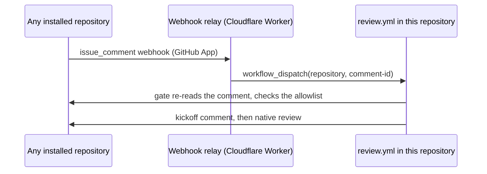

> [!WARNING]
> This is a proof-of-concept repo. Do not rely on it.

# Codjiflo Reviewer

A mention-triggered GitHub PR reviewer for trusted self-hosters. One deployment serves every repository its GitHub App is installed on: repositories need no workflow, variable, secret, or runner of their own. Requires Node.js 22+, Git, and Oh My Pi (`omp`) with access to the selected model. Both Codex and Claude presets run through OMP; there is no standalone reviewer CLI, SDK adapter, or Codjiflo credential pool. No multi-tenant infrastructure.

Comment on an open PR:

```text
@codjiflo-reviewer review
@codjiflo-reviewer review opus-xhigh full
@codjiflo-reviewer review sol-medium
@codjiflo-reviewer review codex
@codjiflo-reviewer review claude full
@codjiflo codex
@codjiflo claude full
@codjiflo sol-medium incremental
```

`@codjiflo` and `@codjiflo-reviewer` are both accepted. An explicit command mention may appear after ordinary prose (for example, `Owner authorized option (A). @codjiflo codex`), but the command and all its options must stay on the same line. Use `@codjiflo review [preset] [full|incremental]` or the shorthand `@codjiflo <preset> [full|incremental]`. Explicit `review` defaults to `opus-xhigh` when no preset is supplied; shorthand requires a known canonical preset or alias immediately after the mention. Commands, presets, aliases, and modes are case-insensitive. After `review`, options are optional and order-independent; both forms allow at most one preset and one mode, and duplicate arguments are rejected. Only newly created issue comments trigger work; editing an existing comment does not.

Bare mentions, casual mentions such as `Thanks @codjiflo for reviewing`, `Could @codjiflo review this?`, or `Thanks @codjiflo claude did great`, unknown shorthand profiles, and commands inside Markdown blockquotes, fenced or indented code blocks, or inline code do not trigger a review. A mention after ordinary prose triggers only if the rest of its line matches the complete command syntax and ends the paragraph: put a blank line before any following prose. A soft line break does not finish an after-prose command, so wrapping `Thanks to @codjiflo claude` onto a following `for the review` line remains inert. An earlier casual mention does not hide a valid standalone command on a later line. A standalone command (the mention starts its line, optionally preceded by whitespace) beginning with `review` or a known profile rejects unknown or duplicate options rather than ignoring them. Inline code before a mention still counts as a nonempty prefix, so `` `x` @codjiflo review turbo `` is ignored rather than reported as an invalid standalone command. For example, `@codjiflo turbo` is ignored, while standalone `@codjiflo review turbo` and `@codjiflo codex turbo` are invalid. Both forms require the same approved original comment author; bot-authored comments never trigger reviews.

## Presets

| Preset | Provider/model default | Model effort | Default e-code-review recipe |
| --- | --- | --- | --- |
| `opus-xhigh` (default; alias `claude`) | OMP `anthropic/claude-opus-5-5` | high | xhigh |
| `sol-xhigh` (alias `codex`) | OMP `openai-codex/gpt-6.1-sol` | high | xhigh |
| `sol-medium` | OMP `openai-codex/gpt-6.1-sol` | medium | high |
| `opus-medium` | OMP `anthropic/claude-opus-5-5` | medium | high |

Preset names and aliases are case-insensitive in mentions and local `--preset` arguments. Aliases resolve to their canonical preset before kickoff, review publication, and baseline selection; they do not add extra presets. An alias and its canonical name still count as two preset arguments and are rejected together in a mention. `sol-high` and `opus-high` have been replaced by `sol-xhigh` and `opus-xhigh`; the old names are no longer accepted. Model effort remains `high`, and medium presets are unchanged. Historical reviews marked with the old names do not match the new presets, so the next review falls back to full scope.

`CODJIFLO_SOL_MODEL` and `CODJIFLO_OPUS_MODEL` override model IDs for their preset families. Overrides must be fully provider-qualified and match the family: `openai-codex/…` for Sol and `anthropic/…` for Opus. Configure a model available through your normal OMP installation; there is no Codjiflo cross-provider fallback. The `codex` and `claude` names are command aliases, not executable selections.

When `.codjiflo/code-review/PROMPT.md` is absent, the default high and xhigh methodology uses eight/ten sequential independent angles (no subagent fanout), deduplication without verification, severity ordering, a gap sweep for xhigh, and caps of ten/fifteen new findings. Outstanding findings from earlier rounds are reassessed separately and do not consume that cap. These instructions are adapted from the e-code-review skill and embedded for both providers; no skill installation is required on the runner. Structured JSON/native GitHub reviews replace ReportFindings. See `src/prompt.mjs` for the complete instructions.

### Repository-specific review instructions

Optionally commit UTF-8 instructions to `.codjiflo/code-review/PROMPT.md` in the repository being reviewed. Codjiflo loads only a regular Git blob directly from the exact inspected **current PR head** tree, not the worktree, default branch, or bot checkout. Its contents **replace the default methodology, even when empty**, for both OMP-backed preset families. Shared review-only, review-scope, JSON verdict, outstanding-finding reconciliation, native GitHub comment-anchor requirements, and the output maximum of ten new findings for medium presets or fifteen for xhigh presets remain enforced. Built-in angles, target finding quotas, reporting conventions, and verifier restrictions do not apply to custom methodology. Only an absent file selects the default methodology. Symlinks at the file or any ancestor, directories in place of the file, submodules anywhere along the path, and other read errors fail the review before OMP is invoked.

Incremental reviews reuse a completed review only when the optional custom prompt has the same regular Git blob identity at the reviewed head and the current PR head (or is absent at both). Adding, deleting, or changing its content forces a full PR review under the current instructions. A valid outstanding-finding ledger is still reconciled during that full review.

## How a mention becomes a review



1. The GitHub App subscribes to **Issue comment** events for every repository it is installed on.
2. [`worker/`](worker/src/index.mjs) verifies the webhook signature and, for a newly created PR comment by a non-bot that contains `@codjiflo`, dispatches [`.github/workflows/review.yml`](.github/workflows/review.yml) on this repository's default branch with the repository name and comment ID. It makes no authorization or command decision. A failed dispatch answers 502, so the delivery shows as failed in the App's delivery log and can be redelivered.
3. The workflow's gate job runs on `ubuntu-latest`, **before scheduling self-hosted review work**. It mints an App installation token for the reviewed repository and re-reads the comment from GitHub: the dispatch inputs only locate it, so author and body never depend on the relay or on whoever started the run. The CLI repeats that lookup and authorization before any API mutation or provider invocation.
4. The review job runs on this repository's self-hosted runners (label `codjiflo-reviewer`), posts a kickoff comment linking the run, and publishes a native review with validated inline findings; if the head or base moved after analysis began, either verdict is published as a neutral `COMMENT` instead.

To review a new repository, install the App on it. Nothing else is per-repository.

Every gate run prints one concise `gate:` decision line and adds it to the Actions job summary. It includes `allowed`, `reason`, the comment author, comment ID, and PR number; accepted requests also include provider, canonical preset, and mode. Denials distinguish `not-a-command`, `bot-author`, `not-approved`, `invalid-command`, and `not-a-pr`. An invalid standalone command from an approved author records its decision before failing the gate. Casual `@codjiflo` mentions still create a hosted gate run, but are explicitly denied and never schedule the self-hosted review job. Starting the workflow by hand with a repository and comment ID is equivalent to a relayed mention and is authorized the same way.

Bot implementation checkout is always this repository at the dispatched default-branch revision, **never the PR branch**. The target PR is fetched separately into a disposable Git repository, including fork heads via GitHub's accessible commit objects. It is not built or tested by the orchestrator. The review CLI can read files and use Git to inspect context. Trust must extend to the **PR authors and reviewed contents, including fork PRs**, not merely the base repository or the allowlisted requester. This is not a malicious-input isolation product: removing known publication tokens and fetch headers from the reviewer environment is not an OS sandbox, does not isolate `HOME` or host secrets, and does not prevent reviewer tools or PR-controlled settings from accessing the runner user's files.

### Private repositories

Runs, logs, and artifacts of this public repository are public. For a reviewed repository that GitHub does not report as public, OMP's live output is withheld from the Actions log and the review-result artifact is not uploaded; the review itself is unchanged. Without the artifact, `--publish` recovery is unavailable for that run: request the review again instead. The run title still names the repository, and the gate line names the comment author and PR number.

## Deploy your own instance

1. Fork or copy this repository. Set Actions variable **`CODJIFLO_APPROVED_USERS`** to comma-, whitespace-, or newline-separated GitHub logins, for example `alice,bob`. Matching is exact and case-insensitive. **Unset/empty means nobody is approved.** Repository ownership, association, collaborator status and write permission do not override this list.
2. Create a GitHub App with repository permissions **Contents: read**, **Issues: read**, **Pull requests: read/write**, and **Actions: read/write** (the relay starts the workflow with it), subscribed to **Issue comment**. Set Actions variable `CODJIFLO_APP_ID` and secret `CODJIFLO_APP_PRIVATE_KEY`. Install the App on this repository and on every repository to review.
3. Register trusted Linux self-hosted Actions runners with this repository under the label `codjiflo-reviewer`. Install Git, Node 22+, and current `omp` on its PATH. Configure and authenticate OMP **as the runner OS user** using OMP's normal setup and account pool. Do not copy CLI credentials into Codjiflo, this repository, or Actions artifacts.
4. Deploy the relay and point the App's webhook at it:

   ```sh
   cd worker
   # Edit wrangler.jsonc vars: APP_ID and DISPATCH_REPOSITORY.
   openssl rand -hex 32 | npx wrangler secret put WEBHOOK_SECRET   # also set as the App's webhook secret
   openssl pkcs8 -topk8 -nocrypt -in app-private-key.pem | npx wrangler secret put APP_PRIVATE_KEY
   npx wrangler deploy
   ```

   WebCrypto imports PKCS#8 only, hence the conversion of GitHub's PKCS#1 key. The relay mints a token restricted to `actions: write` on the dispatch repository; it never touches reviewed repositories.
5. Post an allowed mention on an open PR in any installed repository.

Optional Actions variables `CODJIFLO_SOL_MODEL` and `CODJIFLO_OPUS_MODEL` override the presets' provider-qualified OMP models.

### GitHub identity and permissions

Reviews appear under the App's bot identity, which can approve PRs where organization policy blocks `GITHUB_TOKEN` approvals. Every job mints a short-lived installation token scoped to the single reviewed repository with `actions/create-github-app-token`; the workflow's own `GITHUB_TOKEN` only reads this repository. Pull-request write permission also permits comments on PR conversations; Issues write permission is not required. GitHub can reject an approval by the PR's own author. An API rejection is a failed run, never silently converted into approval.

OMP authentication is independent of the GitHub token. Subscription/API access, usage limits and model availability remain your responsibility. The code checks OMP exit status and structured completion; it does not turn quota/auth errors into a clean review.

OMP work has one 45-minute limit; the review job has a 55-minute limit, below the GitHub App token's one-hour lifetime. Timeouts stop OMP and enter the normal failure-reporting path. After an authorized review job fails or is cancelled, a separate `ubuntu-latest` job reports its terminal status on the reviewed PR even if the self-hosted runner disappeared before uploading logs or running cleanup. It mints its own App token, not runner credentials, and submits no review verdict. It suppresses duplicate notices when a bot already posted a failure comment during the same run attempt or a native review carries that attempt's workflow marker. Reporting still requires GitHub-hosted runner availability and API write access; force-cancelling the entire workflow can also stop its reporter. Keep the self-hosted machine running (including WSL for WSL-hosted runners); this notification does not restore a stopped runner or clean its temporary checkout.

### OMP authentication and account selection

OMP owns provider authentication, refresh, automatic quota-aware account selection, and its configured account pool. Codjiflo invokes the ordinary `omp` installation with the selected provider/model and does not pin an account, extract OAuth tokens, copy credentials from standalone CLIs, rotate API keys, or maintain quota/cooldown state. An exhausted account in a standalone Codex or Claude CLI does not establish that OMP's configured account pool is exhausted.

Configure accounts through your normal OMP authentication workflow under the runner OS user. Ensure that user's service environment can find `omp` and its normal configuration. No Codjiflo API-key setup command, routing-state file, SDK installation, or credential migration is required. Existing obsolete Codjiflo pool files are not read. OMP account availability does not guarantee a model will finish a review: unsuccessful or incomplete runs still publish no verdict.

### Per-repository settings

[`repositories.json`](repositories.json) maps `owner/repo` (case-insensitive) to optional `prepareCommand` and `sourceSubmodules`. It is read from this trusted checkout, never from the reviewed repository; repositories without an entry need none.

`prepareCommand` is a single-line trusted host-side setup command. It runs from the bot checkout on the review runner after authorization and before OMP starts. A nonzero exit stops the job without submitting a review and posts a neutral preparation-failure comment with a link to the run logs. Preparation has a five-minute limit. The failure comment omits command output to avoid exposing host secrets.

The disposable PR checkout leaves all submodules uninitialized by default. Set `sourceSubmodules` to an array of exact root-repository gitlink paths, for example `"sourceSubmodules": ["SolidworksMCP-python"]`. Local CLI callers set `CODJIFLO_SOURCE_SUBMODULES='["SolidworksMCP-python"]'`; unset defaults to `'[]'`. Each selected path must be a gitlink in the inspected **current PR head** tree, not a directory, ordinary file, nested dependency path, or pathspec pattern. Malformed JSON, non-array/non-string values, absolute paths, traversal segments, backslashes, control characters, and Git pathspec magic are rejected. Literal wildcard characters in an actual gitlink name are handled literally, never expanded to other dependencies. Unselected submodules retain only their tracked metadata and are not fetched, even if they are private or unavailable.

Only selected root paths are initialized recursively at the exact pinned gitlink commits, including their nested dependencies. Checkout forces `--checkout`, never `--remote` or a submodule's configured merge/rebase update strategy. Fetches use the same sanitized, noninteractive Git authentication environment as the main checkout. For an HTTP(S) base clone URL, the temporary authorization header is scoped to that URL's origin (scheme, host, and port): same-origin submodule paths receive it, but other hosts or ports do not. File and SSH base clones receive no generated HTTP header. The header exists only in the fetch environment, is not persisted to Git config, and is not passed to OMP. Selecting dependencies does **not** broaden the root-repository-scoped publication token or grant access to private repositories; existing runner transport authentication must permit access to every selected repository and its descendants. Any selected dependency fetch failure stops preparation before OMP starts, with no verdict; there is no implicit all-submodules or legacy fallback.

This fetch does not generate ignored build outputs. If repository review instructions require rendered sheets or other generated evidence, consumers must supply evidence for the inspected head (or demonstrably identical inputs), with its provenance and complete required scope. The host-side `prepareCommand` runs before the disposable PR checkout exists; it cannot populate that checkout's `cad/out/` or establish head-specific native proof. A latest release, a different PR head's renders, or source-code predictions are not substitutes for required current-sheet evidence. When that evidence is unavailable, `INCOMPLETE` remains the correct result; installing a submodule or reference bundle alone does not make such a review complete.

For repositories requiring the `developing-solidworks` reference:

```json
{ "owner/repo": { "prepareCommand": "node scripts/prepare-solidworks-docs.mjs" } }
```

The helper resolves the enabled Codex plugin through `codex plugin list --json` and provisions its exact versioned skill directory from an installed Claude offline bundle. Malformed or truncated CLI manifests and Claude registries are reread up to three times, 250 ms apart; every attempt obtains fresh JSON, and persistent invalid data fails closed without selecting an old cache or publishing a readiness marker. It copies reference data only, preserving skill instructions, scripts, and learnings. A valid target is reused without requiring the source cache; an absent or incomplete bundle fails preparation. Plugin-version changes select a new target automatically.

Install the source bundle once as the runner user before configuring this command. Preparation does not download documentation or invoke PowerShell. This optional helper remains a separate Codex plugin integration, not a reviewer execution path; it still requires the installed Codex executable and Claude offline bundle. `CODJIFLO_DOCS_CODEX_BIN` overrides only that helper's Codex executable. OMP can inspect prepared files when their paths are supplied by the review instructions; the helper does not install an OMP skill or establish head-specific generated evidence. Local CLI users should run the same preparation command before invoking the reviewer.

Concurrent preparation waits up to 30 seconds for a live lock owner, then checks the cache again. A stale lock fails with cleanup instructions instead of silently accepting unfinished data.

### Review parallelism

Each self-hosted runner process executes one job at a time, and all reviewed repositories share this repository's runner pool. To allow more simultaneous reviews, register additional runners here with the `codjiflo-reviewer` label and separate installation/work directories and services. They may share a machine, subject to its resources and the provider account's quotas. The per-PR concurrency group still serializes reviews of the same PR. `strategy.max-parallel` applies to matrix jobs and does not control this workflow.

## Incremental review and commit-pinned publication

Incremental is the default. Completed reviews publish a v4 checkpoint with their outstanding findings:

```html
<!-- codjiflo-reviewer:v4 {"head":"<40-character-sha>","base":"<40-character-sha>","preset":"sol-xhigh","kickoffId":123456,"findings":[]} -->
```

Both approvals and changes-requested reviews can establish a checkpoint. Checkpoints are ordered by their GitHub-issued kickoff comment ID, so delayed publication-only recovery cannot replace a newer analysis or resurrect its resolved findings. The selected checkpoint must have valid v4 metadata matching its GitHub `commit_id`, current base, and requested preset. Its head must be an available ancestor of the new head, with unchanged repository review instructions. Both App/bot and PAT-authored reviews participate. Codjiflo then reviews the new diff and reassesses every outstanding finding against the current source, including findings outside that diff.

Review bodies and checkpoint metadata are trusted inputs. Codjiflo does not authenticate marker authors or look up claimed kickoff IDs. The command allowlist controls who can request work; it does not authenticate review history. Checkpoints are not a security boundary against forged native reviews.

Each outstanding finding has a stable UUID, original commit and location, severity, disposition, and description. The model must return exactly one `resolved` or `unresolved` assessment with a reason for every ID. Missing, duplicate, or unknown IDs fail the review without publication. Unresolved findings keep their identity and original disposition across rounds; any remaining blocker prevents approval. Carried findings appear in the summary with their provenance, without reposting stale inline coordinates. Resolving a GitHub thread does not clear the ledger, and Codjiflo does not automatically resolve GitHub threads.

A checkpoint with ten/fifteen findings originating at its own head cannot establish incremental scope: the reporting cap may have hidden additional defects. The next round reviews the full PR while reconciling the reported findings. A larger ledger carried from earlier heads does not by itself trigger this fallback.

Explicit `full`, changed base or preset, rewritten/unavailable history, changed instructions, a superseded `COMMENTED` or dismissed checkpoint, and a same-head rerun use the merge-base-to-head diff. These full scans still reconcile the selected valid v4 ledger. Legacy or malformed marked publications form a barrier without erasing the highest observed kickoff ID: only a strictly newer analysis can establish a replacement checkpoint. Conflicting metadata for the same kickoff ID also forces a full transition scan.

Legacy v1/v2/v3 markers lack the required ledger and force a full review. They are not migrated into empty checkpoints. The first completed v4 review establishes the new ledger, even when it requests changes. Consumers pinned to a SHA must update both the reusable workflow reference and `bot-ref` to receive this behavior. Full Git history is fetched as needed.

The complete ledger is retained in the publication artifact and review body. Oversized review bodies fail before publication rather than truncating outstanding findings.

Inline coordinates come from GitHub's paginated PR file patches, including current filenames for renames. LEFT endpoints must be deleted lines; RIGHT endpoints may be additions or context. Missing or truncated patches leave findings in the summary; PRs exceeding GitHub's 3,000-file limit fail without a verdict. The bot rereads the PR after collecting metadata and aborts before analysis if head or base changed or the PR closed. Base-tip movement is intentionally conservative even if the merge-base remains unchanged, avoiding additional merge-base fetches and API joins.

Each review records the actual reviewed range and PR base snapshot, and is pinned to the inspected head. Before a new POST, the bot checks that the PR is open, both head and base still match, and no newer published analysis has been observed. Like [CodeRabbit's approval rule](https://docs.coderabbit.ai/pr-reviews/automatic-approvals#how-it-works), this checks freshness before approving. Codjiflo publishes either superseded verdict as a neutral `COMMENT`, preserving its feedback. This includes recovery of an older analysis after a newer same-head review. A closed PR is rejected. GitHub may reject historical commits or inline anchors after movement; retrying an unchanged artifact cannot repair a permanent rejection.

Publication also checks the canonical analyzed-checkpoint fingerprint. If another ledger becomes current during analysis, a newer artifact must be reviewed again rather than overwrite findings it never assessed. An older artifact may still publish as a neutral comment when a strictly newer generation is currently present. If that higher generation disappears, recovery fails even when both checkpoint fingerprints are absent; posting the old ledger could otherwise make it current again. The pre-analysis generation high-water mark is retained even if later history reads omit it.

The review-list read, final PR GET, and POST are not atomic. A push, concurrent newer publication, or delayed ambiguous native POST can leave an old native approval or changes request present; a later `COMMENT` does not revoke it. Enable GitHub's dismiss-stale-approvals setting as a best-effort safeguard, but it is not atomic and does not guarantee protection for an approval submitted after a push. A genuinely newer same-revision approval can supersede an earlier changes request. Pushes do not automatically trigger a new review.

Version-2 artifacts retain the validated result, publication identity, analyzed-checkpoint fingerprint, and highest observed kickoff ID before posting to `codjiflo-result-<publication-uuid>.json`; the path is logged. `--output FILE` overrides `CODJIFLO_RESULT_PATH`, and either explicit path overwrites an existing file. Version-1 artifacts lack the analysis snapshot and are rejected; rerun the review to produce a version-2 artifact. The workflow attempts to upload a run/attempt-specific artifact; retention is best-effort, and GHES operators need a supported alternative to `actions/upload-artifact@v4`. The artifact contains review content, not credentials.

To recover without rerunning the model, download the artifact and run `node bin/codjiflo-reviewer.mjs --publish PATH_TO_RETAINED_RESULT.json` with a GitHub token and the original requester in `CODJIFLO_APPROVED_USERS`. Recovery reconciles the publication identity against existing reviews before retrying and preserves the original artifact; a confirmed existing publication succeeds even if the PR later moved or closed. Multiple identity matches fail rather than guessing. Otherwise the same freshness and closure rules apply to each new POST. Reconciliation and retries reduce duplicates but cannot guarantee exactly-once publication when an accepted POST remains temporarily invisible. Preserve the artifact if publication remains unconfirmed.

Only authorized review jobs enter the per-PR concurrency group. Unrelated comments and denied requests cannot displace queued reviews. GitHub retains one running and one pending job per group: a newer authorized request replaces an older pending request, without cancelling the running review.

Malformed JSON, missing structured output, provider failure, contradictory approval with blocking findings, inconsistent initial PR-file snapshots, or a closed PR produce **no new approval**. Invalid/out-of-hunk locations are preserved as summary findings; they are not dropped or assigned invented coordinates. Failures are reported in a comment and Actions logs when the runner and API remain available. Each structured finding carries `disposition: "blocking" | "advisory"`; advisory findings may accompany approval whether inline or in the summary.

Incomplete analysis is represented by structured verdict `INCOMPLETE`, which fails the run and posts only a neutral failure comment, never an approval or changes request. Its model-generated summary is not copied into the public failure comment, even with credential redaction; the comment directs operators to provider logs for details. Missing required docs, unavailable tools, and network failures are reviewer-environment blockers rather than PR defects. `REQUEST_CHANGES` requires a concrete blocking finding; summary-only or advisory-only changes requests are rejected. Real defects with unavailable PR anchors remain findings and are preserved in the native review summary.

## Local CLI

```sh
# Use the runner user's normally authenticated OMP installation.
export CODJIFLO_APPROVED_USERS='your-login'
export GITHUB_TOKEN='your-app-installation-token-or-PAT'
node bin/codjiflo-reviewer.mjs --repo owner/repo --pr 123 --requester your-login --preset claude --full
```

| Invocation | Behavior |
| --- | --- |
| `--repo owner/repo --comment ID` | Workflow path: re-reads the comment, authorizes its author, and reviews as that comment requests |
| `--repo owner/repo --comment ID --gate` | Authorization/command check only; logs its decision and writes an Actions summary, sets `allowed` and `provider` in `GITHUB_OUTPUT`, plus `number`, `visibility`, `prepare-command`, and `source-submodules` for accepted requests; read-only API calls, no provider calls |
| `--repo owner/repo --pr N --requester login` | Trusted local invocation, default `opus-xhigh` incremental; still requires allowlist |
| `--preset PRESET` | Select one of the four canonical presets or the `codex`/`claude` aliases |
| `--full` | Full review in local invocation |
| `--output FILE` | Retain the validated publication payload outside temporary review worktrees |
| `--publish FILE` | Reconcile/retry a retained review without invoking OMP |
| `--help` | Print usage |

Local `--requester` is an operator assertion, not remote authentication. Do not expose this CLI as an unauthenticated service. Comment-based runs always use the fetched comment's author instead.

Other environment: `GH_TOKEN` is a fallback for `GITHUB_TOKEN`; `GITHUB_API_URL` supports GitHub Enterprise/the fixture server; PR metadata supplies its clone URL. `CODJIFLO_OMP_BIN` overrides the reviewer OMP executable path (also used by fixtures). `CODJIFLO_DOCS_CODEX_BIN` independently overrides Codex for the optional documentation helper only. `GITHUB_RUN_ID`, `GITHUB_REPOSITORY`, and `GITHUB_SERVER_URL` build kickoff links to the run in the repository hosting the workflow.

The disposable checkout and reviewer receive a copied environment without caller repository selectors (`GIT_DIR`, `GIT_WORK_TREE`, index/object/common-directory overrides, namespaces, discovery ceilings, and related Git-local variables), inherited pathspec modes (`GIT_ICASE_PATHSPECS`, `GIT_GLOB_PATHSPECS`, `GIT_NOGLOB_PATHSPECS`, and `GIT_LITERAL_PATHSPECS`), or command-level config overrides (`GIT_CONFIG`, `GIT_CONFIG_PARAMETERS`, `GIT_CONFIG_COUNT`, and indexed `GIT_CONFIG_KEY_n`/`GIT_CONFIG_VALUE_n`). Selector names are matched case-insensitively. This keeps Git inspection pinned to the fetched PR rather than a caller's checkout and prevents inherited pathspec magic from breaking current-head repository-instruction lookup. Git installation, TLS, and authentication transport settings such as `GIT_EXEC_PATH`, `GIT_SSL_CAINFO`, and `GIT_SSH_COMMAND` remain available. Normal trusted host Git configuration still applies, including operator selectors `GIT_CONFIG_GLOBAL`, `GIT_CONFIG_SYSTEM`, and `GIT_CONFIG_NOSYSTEM`; this is not a universal Git-configuration sandbox. The orchestrator adds its GitHub authorization header only to its own Git commands. The reviewer receives neither that header nor inherited `GITHUB_TOKEN`/`GH_TOKEN` variables (including mixed-case spellings), while provider API credentials remain available. Publication retains the orchestrator's GitHub credentials.

Both preset families invoke OMP in print/JSON mode with the selected model and thinking effort, no persistent session, and a trusted Codjiflo extension exposing `final_review`. Codjiflo limits active reviewer tools to `read`, `grep`, `glob`, `find`, `bash`, and `final_review`, and disables normal extension/skill/rule loading for the invocation. Tool selection and extension hooks are **policy controls, not an OS sandbox**: in particular, allowed Bash commands can write files, access the network, and access runner-user secrets. The review-only prompt does not make arbitrary PR contents safe. Use only trusted PR authors and contents on a trusted runner. Temporary runtime scratch/cache paths are outside the checkout and staged evidence and are cleaned up with the invocation.

Prompts up to 512 Ki UTF-16 code units are unchanged and sent inline; preparation and execution share the same budget constant. Larger reviews keep the **complete methodology and output/validation rules in the initial prompt**, while staging structured evidence outside the PR-controlled checkout: `review-scope.diff`, authoritative current-PR `pr-patches.json`, and a JSON-lines inventory with per-file additions/deletions, rename metadata, and exact UTF-8 byte ranges in the staged text. Each scope record carries its `scope` range and, when its current filename matches the current PR API response, its primary `api` range and `anchors` value (`"inline"` for valid inline anchors, `"none"` otherwise). Alternate API records connected through current or previous filenames are retained in `apiRelated`, each with its API filename, optional previous filename, range, and the same `anchors` enum. These alternates support location mapping when Git and GitHub detect renames differently, including LEFT anchors; the selected API record's current filename is always the publication path. API-only files retain standalone records without `scope`. A small manifest names these files and gives total counts/sizes; it does not embed an unbounded filename list. The reviewer enumerates the inventory and processes **every scope file and hunk incrementally**, retaining a compact coverage ledger and API ranges across bounded batches and applying the full methodology. Current-PR API records are consulted directly by retained range for anchor mapping, without repeated inventory scans or obligatory duplicate-diff ingestion. Evidence-mode instructions name the staged files rather than referring to absent inline patches; small inline prompts retain their shape.

Staged reviews also include `prior-findings.json`, with its count and byte size in the manifest. The same bounded reader exposes this ledger, and the model must read and reconcile every entry even when the incremental diff is empty.

Each inventory scope range contains the complete staged patch text for that file, including both deletion and addition blocks when Git represents a file/symlink type change as two blocks. Review diffs are UTF-8-decoded text returned by `runProcess`: invalid source bytes become U+FFFD replacement characters. Scope byte ranges refer to that staged text re-encoded as UTF-8, not raw Git output. The prompt gives a pinned scope inspection command, not a promise of byte-exact raw regeneration: `git -c core.quotePath=false diff --no-color --no-ext-diff --no-textconv --find-renames --submodule=short --src-prefix=a/ --dst-prefix=b/ --unified=3 SCOPE HEAD --`. If non-UTF-8 content is relevant to the review, inspect the original blob with byte-safe tools. For per-file inspection it adds `--literal-pathspecs` before `diff` and safely quoted old/new paths after `--`. These flags pin color, external diff/text conversion, rename detection, path quoting, prefixes, context and gitlink formatting; other inherited Git settings are not universally overridden. Only LF delimits Git patch headers; carriage returns and Unicode line/paragraph separators in file content do not create file boundaries. A repository-supplied methodology replaces the default angles and gap sweep in navigable reviews just as it does for inline reviews; complete evidence coverage remains required.

A trusted `read-evidence.mjs` helper reads at most the shared `MAX_EVIDENCE_READ_BYTES` budget in `src/input-budget.mjs` per call, preserves Unicode boundaries, and reports the next byte offset. The prompt derives its minimum output-token request from that byte budget at one token per byte plus a metadata margin, rather than assuming a favorable tokenization ratio. The reviewer retries the same offset with smaller ranges if tool output truncates and reconciles complete scope coverage before returning. Repository filenames remain JSON data (including escaped tabs/newlines, quotes, Unicode and rename paths), never staging paths or executable shell syntax. Evidence files are read-only and removed with the disposable review directory. Oversized custom methodology or an inventory record that cannot fit a bounded read fails closed before invoking OMP; instructions and scope are never truncated or hidden in ordered prompt fragments. This is not a context-limit bypass. Presets, anchor validation and publication validation are unchanged.

Remaining files or unfinished analysis are not blockers: the reviewer is instructed to continue while evidence and tools remain available. `INCOMPLETE` is reserved for an observed constraint that prevents further required analysis after recovery attempts; its summary must identify that constraint and the remaining coverage. This is a model instruction, not an orchestrator-enforced coverage guarantee. An incomplete result still publishes no native verdict.

OMP must emit exactly one `final_review` tool start with the structured verdict, its matching non-error tool completion, and a final `agent_end` whose last assistant message has `stopReason: "stop"`, in addition to exiting successfully. The host validates the submitted arguments against the review schema; assistant prose is not a verdict. Missing, duplicate, malformed, or failed tool completion and unsuccessful agent/process completion reject even a valid-looking payload. Non-JSON stdout fails closed with a fixed protocol diagnostic. Raw tool/model output, extra event fields, stderr, and JSON parser excerpts are not copied into public failure comments; raw streams remain in process/Actions logs. Public diagnostics are bounded and redact known credential values.

The public failure-comment sink independently redacts the GitHub client's publication token and known credential values from the orchestrator environment before truncating diagnostics. This includes `GITHUB_TOKEN`/`GH_TOKEN` even though those variables are removed from the reviewer environment; provider-secret redaction remains in place. Redaction covers known literal values, not arbitrary host data or encoded credentials, and does not change the trusted-runner boundary described above.

Process failures carry structured `termination` metadata (`timeout`, `exit`, `signal`, or `spawn`) instead of inferring the cause from diagnostic wording. Timeout and unsuccessful-close errors retain `exitCode` and `signal`; spawn failures retain the operating-system error code. Public OMP failure status uses this metadata while raw process output remains in logs.

## Development and deterministic verification

```sh
npm ci
npm test
npm run smoke
```

Tests cover authorization, native review coordinates, approval and changes-requested checkpoints, multi-round finding reconciliation, incompatible and legacy checkpoint fallbacks, malformed results, superseded publication, initial snapshot consistency, closed-PR rejection, publication-only recovery, subprocess deadlines, secret redaction, OMP invocation and completion validation, and the shared tool-policy contract.

The smoke runs the **real entry point and orchestration**, native fetch against a loopback GitHub fixture, Git fetch/checkout of a temporary repository, and a fixture OMP executable for both preset families. It checks native review payloads and LEFT/RIGHT ranges, approval withholding and changes requests pinned through head/base movement, initial snapshot rejection before model invocation, and closed-PR rejection. The deterministic suite makes no paid model calls or remote writes and cleans up afterward; hosted CI needs no self-hosted runner or live authentication. Historical-commit and inline-coordinate acceptance on real GitHub remains subject to the API, not established by these fixtures.

Fixture executables prove adapter behavior, not real OMP authentication, account selection, model analysis, or OS isolation. Live acceptance requires the installed OMP and actual model to consume evidence and produce the structured verdict; a fixture payload or copied CLI options alone is not that proof.

Opt-in native smokes exercise the installed OMP and actual models:

```sh
node test/omp-native-smoke.mjs sol-medium
node test/omp-native-smoke.mjs opus-medium
node test/omp-incremental-native-smoke.mjs sol-medium
node test/omp-incremental-native-smoke.mjs opus-medium
```

They require `omp` on PATH and normally authenticated OMP accounts with access to the selected models, and consume model quota. They require the model to inspect source evidence containing a fresh nonce and submit its own structured verdict, then verify publication against the local GitHub fixture. They make no remote GitHub writes and do not require executing scripts from the reviewed code. These live smokes are separate from deterministic CI and are not proof of an OS sandbox.

The incremental native smoke exercises three real-model rounds: a blocking finding, an unrelated change that must retain it under incremental scope, and a fix that must resolve it before approval. It verifies that the old defect is absent even from the second round's delivered diff context. Each round checks source-nonce consumption and native publication to the loopback server.
